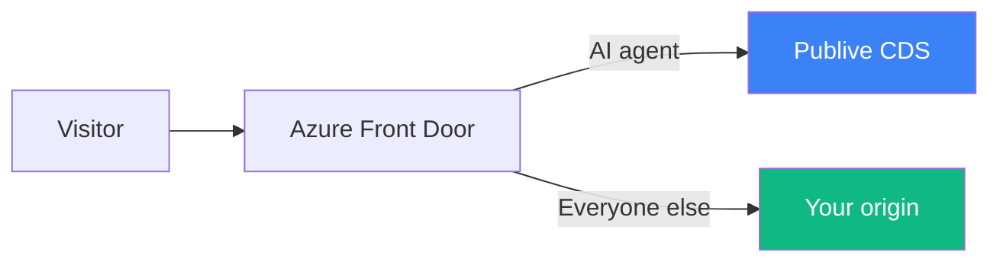
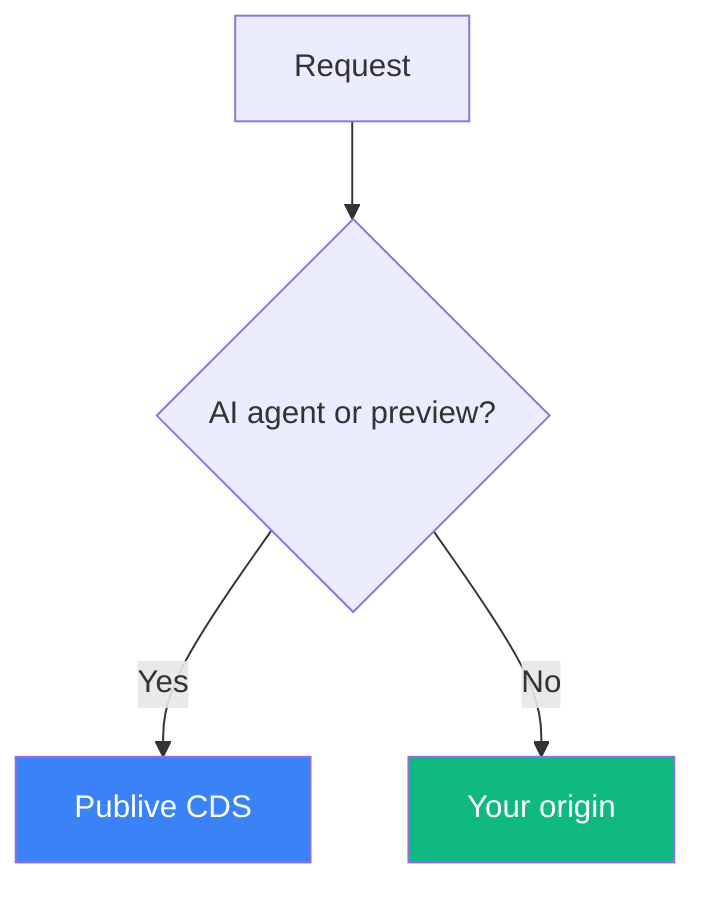

This guide adds an origin group and one rule set to the Azure Front Door profile that already fronts your domain. The rules check each request's user-agent and preview header; requests from recognized AI agents (GPTBot, ClaudeBot, PerplexityBot, and similar) and preview requests go to the Publive CDS backend instead of your origin. Everything else — human visitors and SEO bots — passes through untouched.

There's no code to deploy. Everything is configured in the Azure portal.

<Note>
  This guide targets **Azure Front Door Standard or Premium**, which is Microsoft's current CDN offering. If you're on **Azure CDN Standard from Microsoft (classic)** or **Azure Front Door (classic)**, migrate to Front Door Standard/Premium first. The classic tiers retire in 2027 (Front Door classic on March 31, Azure CDN classic on September 30), and this guide relies on rule-set features (server variables, route configuration override) that only Standard and Premium document.
</Note>

<Note>
  Make sure `PubliveBot/1.0 (+https://axp.thepublive.com/bot)` is unblocked on your CDN, including in your Front Door WAF policy (and its Bot Manager rule set, if you're on Premium). CDS fetches your origin pages to build the agent view, so if this is blocked, nothing works.
</Note>

<Note>
  Make sure LLM user agents (GPTBot, ClaudeBot, PerplexityBot, and similar) are unblocked on your CDN, in `robots.txt`, and in any firewall/WAF rules. Front Door runs WAF before rule sets, so if WAF blocks a bot, that traffic never gets a chance to route to AXP Edge.
</Note>

## Prerequisites

- An Azure Front Door Standard or Premium profile already serving your domain, and permission to edit its origin groups, rule sets, and routes.
- Your site's pages served by a single route matching `/*`, with no **origin path** set on that route. See [Limitations](#limitations).
- Your Publive Edge CDS API key (issued per client, [support@thepublive.com](mailto:support@thepublive.com) if you don't have one).

## Cost

If you're already on Front Door Standard or Premium, this integration adds no fixed cost:

- Rule sets, rules, and origin groups have no separate charge on Standard or Premium.
- Agent requests are already billed as requests today. Routing them to CDS only adds edge-to-origin transfer for the request itself, which is negligible for `GET` and `HEAD`.

Two things do show up on your bill:

- **CDS fetching your pages.** When CDS builds or refreshes an agent view, it requests the page from your domain through Front Door, and renders it in a headless browser, which also loads the page's scripts, stylesheets, and images. These are ordinary requests and egress on your profile. For pages CDS can build, this happens once per page per refresh, not per agent visit. For pages it can't (404s, non-HTML responses, timeouts), it happens on every agent visit, so exclude non-HTML paths (see the Request path note in step 2).
- **Migrating from a classic tier.** Azure CDN Standard from Microsoft (classic) has no base fee. Front Door Standard has a monthly base fee plus per-request pricing. See [Azure Front Door pricing](https://azure.microsoft.com/en-us/pricing/details/frontdoor/).

Nothing in this guide requires the Premium tier.

## How routing works

### Components



| Component | Role |
| --- | --- |
| **Azure Front Door** | Your existing profile. The `AxpEdge` rule set checks each request and decides where it goes. |
| **Your origin** | Serves humans and SEO bots exactly as today. |
| **Publive CDS** | Serves AI agents an agent-optimized version of your page. It fetches the original from your site (through Front Door) when it needs to build or refresh it. |

### Rule decision

A request goes to AXP Edge only when all of these are true:

- The hostname matches your domain.
- The method is `GET` or `HEAD`, and the path isn't a static asset (`.js`, `.css`, images, fonts, feeds, and similar are always skipped).
- The user-agent matches a known AI agent or PubliveBot, or the request carries `x-pl-preview: 1`.
- The request doesn't carry `x-pl-fetch` (the loop guard).

Anything else falls through to your origin exactly as before.

A request with the header `x-pl-skip: 1` opts a matching user-agent out of routing, so it goes to your origin. The skip header never overrides the preview flag.

Front Door has two constraints that shape the setup:

- **Conditions within a rule are AND-ed.** "AI agent user-agent" and "preview header" can't be OR-ed in one rule, so the bot and preview cases each get their own rules.
- **A rule can have at most 5 actions.** Routing needs 6 (the origin override, the URL rewrite, and 4 headers), so each case is split across two rules with identical conditions: one sets the headers, the next one routes.

That gives four rules in one rule set (see [Add the rules](#set-up-the-integration)). Together they make one decision:



Every routed request is sent to the single CDS endpoint `cds.thepublive.com/axp/view/`, and the original page path travels in the `x-pl-url` header, matching the [Cloudflare](/axp/axp-edge/integrations/cloudflare) and [Vercel](/axp/axp-edge/integrations/vercel) integrations. So `www.example.com/pricing` becomes a request to `/axp/view/` with `x-pl-url: /pricing`. A **URL rewrite** action replaces the path.

<Warning>
  Front Door has no per-request origin failover. Unlike the Cloudflare, CloudFront, and Akamai integrations, a CDS error is returned to the AI agent instead of falling back to your origin. Human visitors are never affected, because their requests never match these rules. See [Failover](#failover) for what that means in practice.
</Warning>

### Header reference

| Header | Set by | Read by |
| --- | --- | --- |
| `x-pl-fetch` | CDS, when it fetches your pages | Rule conditions (loop guard, presence only) |
| `x-pl-preview` | Client | Preview rules only |
| `x-pl-skip` | Client | Bot rules only |
| `x-pl-api-key`, `x-pl-host`, `x-pl-url`, `x-pl-client-agent` | Header rules | CDS backend only |
| `x-pl-request-id` | CDS backend | Nothing (output tag for verification) |

Every `x-pl-*` header sent to CDS is set with **Overwrite**, so a client can't spoof one. Any inbound value is replaced.

## Set up the integration

<Steps>
  <Step title="Create the CDS origin group">
    In your Front Door profile, go to **Settings → Origin groups → Add**:

    - **Name**: `publive-cds`

    Add one origin to it:

    | Setting | Value |
    | --- | --- |
    | Origin type | Custom |
    | Host name | `cds.thepublive.com` |
    | Origin host header | `cds.thepublive.com` |
    | HTTPS port | `443` |
    | Certificate subject name validation | Enabled |
    | Priority / Weight | `1` / `1000` |

    Don't associate this origin group with any route. The rule set picks it per request, and your existing route and origin group stay exactly as they are.

    Your real host reaches CDS in the `x-pl-host` header, so sending `cds.thepublive.com` as the host header is correct. It lets CDS terminate TLS and resolve its own vhost.
  </Step>
  <Step title="Create the rule set">
    Go to **Settings → Rule sets → Add**, and name it `AxpEdge`. Front Door rule names allow letters and numbers only, so the rules below use names like `AxpEdgeBotHeaders`.

    The two **Bot** rules share these seven conditions:

    | Condition | Settings |
    | --- | --- |
    | **Host name** | Operator `Equal`, value `www.example.com` |
    | **Request method** | Operator `Equal`, values `GET`, `HEAD` |
    | **Request file extension** | Operator `Not Equal`, case transform `To lowercase`, values: `js` `css` `map` `json` `xml` `txt` `rss` `atom` `webmanifest` `ico` `png` `jpg` `jpeg` `gif` `svg` `webp` `avif` `woff` `woff2` `ttf` `mp4` `webm` `mp3` `pdf` `zip` |
    | **Request header** `x-pl-fetch` | Operator `Not Any` |
    | **Request header** `x-pl-skip` | Operator `Not Equal`, value `1` |
    | **Request header** `x-pl-preview` | Operator `Not Equal`, value `1` |
    | **Request header** `User-Agent` | Operator `Contains`, case transform `To lowercase`, values below |

    ```
    gptbot
    oai-searchbot
    chatgpt-user
    claudebot
    claude-user
    claude-searchbot
    anthropic-ai
    perplexitybot
    perplexity-user
    publivebot
    ```

    Enter the values in lowercase, because the case transform lowercases the header before comparing. Add or remove AI agents per domain, but keep the two Bot rules identical, and keep `publivebot`: Publive's connection check identifies itself as PubliveBot, and the dashboard only shows your CDN as connected when that request reaches CDS. The `x-pl-fetch` condition stops CDS's own page fetches, which also use PubliveBot, from looping back into CDS.

    The two **Preview** rules use the same Host name, Request method, Request file extension, and `x-pl-fetch` conditions. They replace the `x-pl-skip`, `x-pl-preview`, and `User-Agent` conditions with one: **Request header** `x-pl-preview`, operator `Equal`, value `1`.

    <Note>
      Keep each condition to 25 values or fewer. Front Door rejects more, so add file extensions only by swapping out ones your site doesn't use.
    </Note>

    <Note>
      The `x-pl-preview` condition on the Bot rules keeps the two pairs mutually exclusive. Without it, a bot request that also sends `x-pl-preview: 1` runs all four rules, and the Preview Headers rule reads `{url_path}` after the Bot Route rule has already rewritten it.
    </Note>

    <Note>
      Multiple values in one condition are OR-ed, and separate conditions are AND-ed. An extensionless page URL like `/pricing` has an empty extension, so it passes the `Not Equal` condition and is routed.
    </Note>

    <Note>
      If your site serves non-HTML content at paths without a file extension, such as `/feed/` or `/wp-json/`, add one more condition to all four rules: **Request path**, operator `Not Begins With`, values like `feed` and `wp-json`. CDS only builds agent views of HTML pages, and anything else returns an error to the agent (see [Failover](#failover)).
    </Note>
  </Step>
  <Step title="Add the rules">
    Add **AxpEdgeBotHeaders** first, with the Bot conditions and these actions:

    | Action | Settings |
    | --- | --- |
    | **Modify request header** | `Overwrite` `x-pl-api-key` = your Edge CDS API key |
    | **Modify request header** | `Overwrite` `x-pl-host` = `{hostname}` |
    | **Modify request header** | `Overwrite` `x-pl-url` = `/{url_path}` |
    | **Modify request header** | `Overwrite` `x-pl-client-agent` = `{http_req_header_User-Agent}` |

    Then add **AxpEdgeBotRoute**, with the same Bot conditions and these actions:

    | Action | Settings |
    | --- | --- |
    | **Route configuration override** | Override origin group `Yes` → `publive-cds`, forwarding protocol `HTTPS only`. Caching `Disabled` |
    | **URL rewrite** | Source pattern `/`, destination `/axp/view/`, preserve unmatched path `No` |

    Then add **AxpEdgePreviewHeaders** and **AxpEdgePreviewRoute** with the Preview conditions and the same actions as their Bot counterparts.

    Keep each Headers rule **above** its Route rule. `{url_path}` must be read before the URL rewrite replaces the path, or every page arrives at CDS as `x-pl-url: /axp/view/`. `{url_path}` has no leading slash, so the `/` before it is required.

    Leave **Stop evaluating remaining rules** off on all four. Each pair needs both of its rules to run.

    <Warning>
      Caching must be `Disabled` in the route configuration override. CDS caches agent views itself, and this guarantees an agent response can never be stored under the same cache key as the human page.
    </Warning>

    <Note>
      The API key is stored in the rule configuration, so anyone with read access to the Front Door profile can see it. Restrict profile access with Azure RBAC, and rotate the key through Publive if it's exposed.
    </Note>
  </Step>
  <Step title="Associate the rule set with your route">
    Open **Settings → Front Door manager**, edit the route serving your site's pages (the one matching `/*` on your domain), and add the `AxpEdge` rule set.

    Rule sets run in the order listed on the route. Put `AxpEdge` **last**, and check that no earlier rule set:

    - has **Stop evaluating remaining rules** on for page requests, which would stop `AxpEdge` from running, or
    - rewrites page URLs, such as a single-page-app rewrite to `/index.html`, which would send every page to the same agent view.

    Also check that no later rule set overrides the origin group, rewrites the URL, or re-enables caching for these requests.

    Save. Front Door configuration changes take a few minutes to propagate to all edge locations.
  </Step>
</Steps>

## Verify

- **Bot traffic**: a request with an AI agent user-agent returns `x-pl-request-id`, confirming it was served by CDS.
- **Human traffic**: a normal browser request has no `x-pl-request-id`, and content and response time are unchanged.
- **Preview**: a request with a normal browser user-agent and `x-pl-preview: 1` returns `x-pl-request-id`, confirming the Preview rule matches.
- **HEAD requests**: a `HEAD` request with an AI agent user-agent returns `x-pl-request-id`.
- **Skip**: a bot request with `x-pl-skip: 1` has no `x-pl-request-id`.
- **Loop guard**: a bot request with `x-pl-fetch: 1` has no `x-pl-request-id`.
- **Right page**: request two different bot URLs and confirm you get two different pages. This is the check that `x-pl-url` carries the original path, not the rewritten one.
- **Encoded paths**: if your site has URLs with non-ASCII characters or spaces, request one with a bot user-agent and confirm you get that page, not a `424`.

```bash
curl -svo /dev/null https://www.example.com/pricing \
  --header "user-agent: ChatGPT-User"
```

```
< HTTP/2 200
< x-pl-request-id: 50fce12d
< x-azure-ref: 20261015T101530Z-...
```

`x-azure-ref` confirms the request went through Front Door rather than straight to your origin.

For the preview, HEAD, skip, and loop guard checks:

```bash
# Preview: non-bot user-agent with the preview header
curl -svo /dev/null https://www.example.com/pricing \
  --header "user-agent: Mozilla/5.0 (Macintosh; Intel Mac OS X 10_15_7)" \
  --header "x-pl-preview: 1"

# HEAD: bot user-agent
curl -sI https://www.example.com/pricing \
  --header "user-agent: ChatGPT-User"

# Skip: bot user-agent opted out, expect no x-pl-request-id
curl -svo /dev/null https://www.example.com/pricing \
  --header "user-agent: ChatGPT-User" \
  --header "x-pl-skip: 1"

# Loop guard: expect no x-pl-request-id
curl -svo /dev/null https://www.example.com/pricing \
  --header "user-agent: PubliveBot/1.0 (+https://axp.thepublive.com/bot)" \
  --header "x-pl-fetch: 1"
```

Routing status also shows in the AXP Edge dashboard under **Brand Configuration → Integrations → CDN**. It turns green once Publive's connection check, a PubliveBot request to your homepage on your registered domain, comes back with `x-pl-request-id`. The check follows redirects, so if your apex redirects to `www`, matching only `www.example.com` is enough. Put only hostnames registered with Publive in the Host name condition; any other hostname gets a `403` from CDS.

## Troubleshooting

| Symptom | Fix |
| --- | --- |
| Bot request not routed (no `x-pl-request-id`, origin response) | Wait a few minutes after saving. Check the Host name matches exactly and User-Agent values are lowercase. |
| `403` from Front Door | Allow AI agent user-agents and PubliveBot in your WAF policy. |
| `401` from CDS | Check `x-pl-api-key` in both Headers rules. |
| `403` from CDS | Register the hostname with Publive, including any `www.` prefix. |
| `424` from CDS | CDS couldn't fetch the page. Allowlist PubliveBot at your origin, or exclude non-HTML paths. |
| Every bot URL returns the same page | Move each Headers rule above its Route rule. |
| `404` on every bot request | Attach `AxpEdge` to the `/*` route, with no origin path. |
| Rule matches but origin content is served | Move `AxpEdge` last on the route. |
| Rule set won't save | Keep each condition to 25 values or fewer. |
| Dashboard status not green | Add `publivebot` to the User-Agent values. |

## Limitations

- **One `/*` route, no origin path.** The URL rewrite only applies to the part of the path after the route's pattern, and keeps the pattern in front. On a `/news/*` route, `/news/story` becomes `/news/axp/view/`, which CDS doesn't serve. An origin path on the route is also kept in front of `/axp/view/`. Requests matching a more specific route than `/*` aren't covered by a rule set attached to `/*`.
- **Query strings are ignored.** CDS builds one agent view per path, so `/article?id=1` and `/article?id=2` get the same page. Sites that select content by query string shouldn't route those paths to AXP Edge.

## Failover

The Cloudflare, CloudFront, and Akamai integrations catch a CDS error and serve the request from your origin instead. Front Door can't do this:

- Rule sets run before the request reaches an origin, so no rule can react to the origin's response status.
- Origin group failover can't fall back to your origin either, because the URL rewrite has already changed the path to `/axp/view/`.

So the AI agent receives whatever CDS returns. In practice:

- If CDS is down or unreachable, the agent gets the error.
- The first time CDS sees a page, it fetches it from your origin. If your origin returns anything other than a `200` HTML page, the agent gets a `424` instead. That includes real 404 pages and non-HTML responses at routed paths.
- Redirects from your origin are followed, so the agent receives the final page at the original URL rather than the redirect.

Human visitors are never affected. To take AXP Edge out of the path, follow [Rollback](#rollback).

If your site needs per-request failover for agent traffic, contact [support@thepublive.com](mailto:support@thepublive.com) before you go live.

## Rollback

Remove the `AxpEdge` rule set from the route (or delete its four rules) and save. Traffic returns to your origin once the change propagates, usually within a few minutes, and there's no origin-side state to unwind. The `publive-cds` origin group is harmless to leave in place.

## Next steps

<CardGroup cols={2}>
  <Card title="AXP Edge dashboard" icon="gauge" href="/axp/axp-edge/dashboard">
    Monitor agent traffic and manage optimization rules.
  </Card>

  <Card title="Deploy on Cloudflare" icon="/images/axp/logos/cloudflare.svg" href="/axp/axp-edge/integrations/cloudflare">
    Not on Azure? Use the Cloudflare Worker-based guide instead.
  </Card>
</CardGroup>
